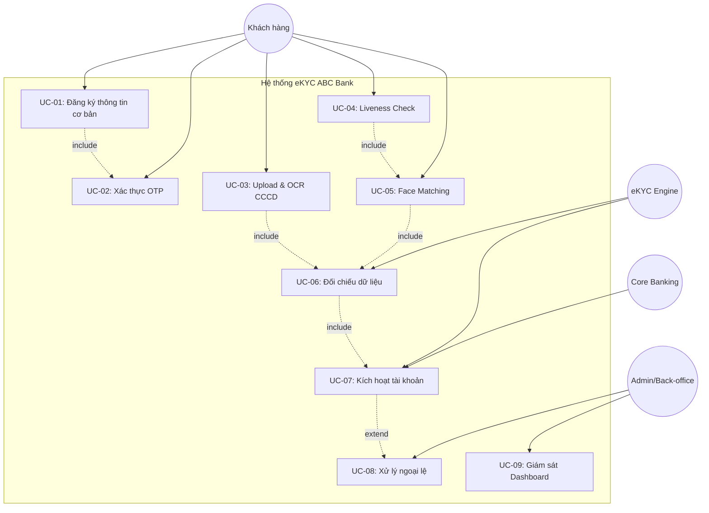
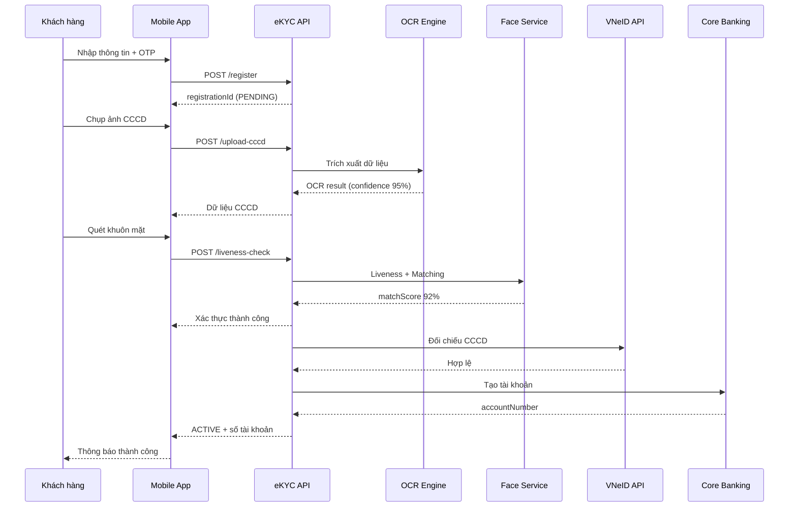

# SOFTWARE REQUIREMENTS SPECIFICATION (SRS)
## Hệ thống eKYC - Mở tài khoản trực tuyến ABC Bank

| Thuộc tính | Giá trị |
|-----------|---------|
| **Mã tài liệu** | SRS-ABC-EKYC-001 |
| **Phiên bản** | 1.0 |
| **Ngày phát hành** | 10/07/2026 |
| **Trạng thái** | Đã phê duyệt - Sẵn sàng bàn giao Dev/QA |
| **Tác giả** | Nhóm Business Analyst - ABC Bank |

---

## MỤC LỤC

1. [Introduction](#1-introduction)
2. [Overall Description](#2-overall-description)
3. [Specific Functional Requirements](#3-specific-functional-requirements)
4. [Non-Functional Requirements](#4-non-functional-requirements)
5. [Visual Diagram](#5-visual-diagram)
6. [Traceability Matrix](#6-traceability-matrix)
7. [Document History](#7-document-history)

---

## 1. INTRODUCTION

### 1.1. Purpose (Mục đích tài liệu)

Tài liệu SRS này mô tả đầy đủ và chính thức các yêu cầu phần mềm cho tính năng **eKYC (Electronic Know Your Customer)** của ABC Bank. Tài liệu được sử dụng để:

- Bàn giao (Handover) cho đội Development triển khai hệ thống
- Làm cơ sở cho đội QA thiết kế Test Case và kiểm thử
- Làm tài liệu tham chiếu cho các bên liên quan (Stakeholder)

### 1.2. Scope (Phạm vi hệ thống)

**Trong phạm vi (In Scope):**

- Đăng ký thông tin cơ bản qua Mobile App
- Upload và OCR ảnh CCCD (mặt trước, mặt sau)
- Xác thực khuôn mặt (Liveness Detection + Face Matching)
- Đối chiếu dữ liệu tự động với CSDL quốc gia
- Tạo và kích hoạt tài khoản tự động (Zero manual operation)
- Gửi thông báo kết quả qua SMS/Email/Push

**Ngoài phạm vi (Out of Scope):**

- Đăng ký qua VNeID/eID (Giai đoạn 2)
- Mở thẻ tín dụng
- Vay vốn trực tuyến
- Xử lý hồ sơ doanh nghiệp

### 1.3. Definitions, Acronyms (Thuật ngữ)

| Thuật ngữ | Định nghĩa |
|-----------|-----------|
| **eKYC** | Electronic Know Your Customer - Xác minh danh tính khách hàng điện tử |
| **OCR** | Optical Character Recognition - Nhận dạng ký tự quang học, trích xuất text từ ảnh |
| **Liveness Check** | Kiểm tra khuôn mặt thật, chống giả mạo bằng ảnh/video/mặt nạ |
| **Face Matching** | So khớp khuôn mặt live với ảnh trên CCCD |
| **CCCD** | Căn cước công dân - Giấy tờ tùy thân điện tử 12 chữ số |
| **CBS** | Core Banking System - Hệ thống lõi ngân hàng |
| **AML** | Anti-Money Laundering - Phòng chống rửa tiền |
| **NHNN** | Ngân hàng Nhà nước Việt Nam |
| **OTP** | One-Time Password - Mật khẩu dùng một lần |
| **P95** | Percentile 95 - 95% request phản hồi trong thời gian cho trước |

---

## 2. OVERALL DESCRIPTION

### 2.1. Product Perspective (Góc nhìn sản phẩm)

Hệ thống eKYC là một module trong hệ sinh thái ABC Bank, tích hợp với:

```
[Mobile App] → [API Gateway] → [eKYC Service] → [OCR Engine]
                                      ↓
                              [Face Recognition Service]
                                      ↓
                              [VNeID / C06 API]
                                      ↓
                              [Core Banking System]
                                      ↓
                              [Notification Service]
```

Hệ thống hoạt động độc lập về mặt triển khai (microservice) nhưng phụ thuộc vào Core Banking để tạo tài khoản.

### 2.2. User Classes and Characteristics (Đặc điểm người dùng)

| Nhóm người dùng | Đặc điểm | Kỹ năng công nghệ |
|----------------|----------|-------------------|
| **Khách hàng cá nhân** | 18-60 tuổi, cư trú VN, có CCCD hợp lệ | Trung bình - quen dùng smartphone |
| **Back-office Staff** | Nhân viên ngân hàng, xử lý ngoại lệ | Cao - quen hệ thống nội bộ |
| **Admin** | Quản trị viên hệ thống | Cao |
| **Compliance Officer** | Cán bộ tuân thủ, giám sát KYC/AML | Trung bình-Cao |

### 2.3. Constraints (Giới hạn)

| Loại | Ràng buộc |
|------|-----------|
| **Pháp lý** | Tuân thủ Thông tư 23/2014/TT-NHNN, NĐ 13/2023 về bảo vệ dữ liệu cá nhân, Luật An ninh mạng |
| **Công nghệ** | API RESTful, JSON; Hỗ trợ iOS 14+, Android 8+ |
| **Bảo mật** | TLS 1.3, mã hóa AES-256 cho dữ liệu nhạy cảm |
| **Thời gian** | Go-live trong Q4/2026 |
| **Ngân sách** | Sử dụng OCR/Face SDK có sẵn (không tự phát triển AI) |

### 2.4. Assumptions and Dependencies

- ABC Bank đã có hợp đồng tích hợp API VNeID
- Core Banking hỗ trợ REST API tạo tài khoản real-time
- Khách hàng có thiết bị có camera chất lượng ≥ 5MP

---

## 3. SPECIFIC FUNCTIONAL REQUIREMENTS

### 3.1. Module: Đăng ký tài khoản

#### FR-REG-01: Nhập thông tin đăng ký cơ bản

| Thuộc tính | Chi tiết |
|-----------|----------|
| **Mô tả** | Cho phép khách hàng nhập thông tin cá nhân để bắt đầu quy trình eKYC |
| **Input** | `fullName` (string), `phone` (string), `email` (string), `citizenId` (string) |
| **Output** | `registrationId` (UUID), `status` (PENDING), `message` |
| **Business Rules** | BR-01, BR-02, BR-03 |
| **Acceptance Criteria** | - Họ tên không rỗng, tối đa 100 ký tự<br>- SĐT định dạng VN (10 số, bắt đầu 0)<br>- Email hợp lệ RFC 5322<br>- CCCD đúng 12 chữ số<br>- Từ chối nếu SĐT/CCCD trùng |

#### FR-REG-02: Xác thực OTP qua SMS

| Thuộc tính | Chi tiết |
|-----------|----------|
| **Mô tả** | Gửi và xác minh OTP để xác nhận quyền sở hữu SĐT |
| **Input** | `phone`, `otp` (6 chữ số) |
| **Output** | `verified` (boolean), `expiresIn` (seconds) |
| **Acceptance Criteria** | - OTP 6 số, hết hạn sau 3 phút<br>- Tối đa 3 lần nhập sai<br>- Gửi lại OTP sau 60 giây |

---

### 3.2. Module: Upload & Đọc CCCD (OCR)

#### FR-OCR-01: Upload ảnh CCCD

| Thuộc tính | Chi tiết |
|-----------|----------|
| **Mô tả** | Khách hàng upload/chụp ảnh mặt trước và mặt sau CCCD |
| **Input** | `registrationId`, `frontImage` (base64/file), `backImage` (base64/file) |
| **Output** | `uploadStatus`, `imageQualityScore` |
| **Acceptance Criteria** | - Định dạng JPG/PNG, tối đa 5MB/ảnh<br>- Phát hiện ảnh mờ, chói sáng<br>- Yêu cầu chụp lại nếu quality < 70% |

#### FR-OCR-02: Trích xuất dữ liệu OCR

| Thuộc tính | Chi tiết |
|-----------|----------|
| **Mô tả** | Tự động đọc thông tin từ ảnh CCCD |
| **Input** | Ảnh CCCD đã upload |
| **Output** | `citizenId`, `fullName`, `dateOfBirth`, `address`, `confidence` (%) |
| **Business Rules** | BR-05 |
| **Acceptance Criteria** | - Confidence ≥ 90% mới tiếp tục<br>- Đối chiếu OCR với dữ liệu đã nhập<br>- Báo lỗi chi tiết nếu không khớp |

---

### 3.3. Module: Xác thực khuôn mặt

#### FR-FACE-01: Liveness Detection

| Thuộc tính | Chi tiết |
|-----------|----------|
| **Mô tả** | Xác minh khuôn mặt thật, chống giả mạo |
| **Input** | Video stream / ảnh selfie từ camera |
| **Output** | `livenessScore` (0-100), `isLive` (boolean) |
| **Acceptance Criteria** | - Phát hiện ảnh in, video replay, mặt nạ<br>- Hoàn thành trong ≤ 30 giây<br>- Hướng dẫn người dùng bằng tiếng Việt |

#### FR-FACE-02: Face Matching

| Thuộc tính | Chi tiết |
|-----------|----------|
| **Mô tả** | So khớp khuôn mặt live với ảnh trên CCCD |
| **Input** | Ảnh selfie, ảnh chân dung trên CCCD |
| **Output** | `matchScore` (%), `isMatched` (boolean) |
| **Business Rules** | BR-04, BR-09 |
| **Acceptance Criteria** | - Ngưỡng matching ≥ 85%<br>- Tối đa 3 lần thử/phiên<br>- Ghi log kết quả phục vụ audit |

---

### 3.4. Module: Kích hoạt tài khoản

#### FR-ACT-01: Đối chiếu dữ liệu tổng hợp

| Thuộc tính | Chi tiết |
|-----------|----------|
| **Mô tả** | Đối chiếu dữ liệu nhập tay, OCR và CSDL quốc gia |
| **Input** | Toàn bộ dữ liệu từ các bước trước |
| **Output** | `verificationResult` (PASS/FAIL), `mismatchFields` |
| **Acceptance Criteria** | - Gọi API VNeID trong ≤ 5 giây<br>- Xử lý timeout gracefully<br>- AML screening trước khi kích hoạt |

#### FR-ACT-02: Tạo tài khoản tự động

| Thuộc tính | Chi tiết |
|-----------|----------|
| **Mô tả** | Tự động tạo tài khoản khi tất cả bước xác thực PASS |
| **Input** | `registrationId`, dữ liệu khách hàng đã xác thực |
| **Output** | `accountId`, `accountNumber`, `status` (ACTIVE/PENDING) |
| **Business Rules** | BR-06 |
| **Acceptance Criteria** | - Sinh số tài khoản 10-14 chữ số<br>- Retry 3 lần nếu CBS lỗi<br>- Gửi SMS/Email trong 1 phút |

---

## 4. NON-FUNCTIONAL REQUIREMENTS

### 4.1. Security (Bảo mật)

| Mã | Yêu cầu | Tiêu chí |
|----|---------|----------|
| NFR-SEC-01 | Mã hóa dữ liệu CCCD, ảnh khuôn mặt at-rest | AES-256 |
| NFR-SEC-02 | Mã hóa truyền tải | TLS 1.3 |
| NFR-SEC-03 | Xác thực API | JWT Bearer Token, expire 15 phút |
| NFR-SEC-04 | Phân quyền truy cập | RBAC cho Admin/Back-office |
| NFR-SEC-05 | Audit log | Ghi log mọi thao tác trên dữ liệu nhạy cảm, lưu 5 năm |
| NFR-SEC-06 | Tuân thủ bảo vệ dữ liệu cá nhân | NĐ 13/2023, có consent form |

### 4.2. Performance (Hiệu năng)

| Mã | Yêu cầu | Tiêu chí |
|----|---------|----------|
| NFR-PERF-01 | Thời gian phản hồi API đăng ký | ≤ 2 giây (P95) |
| NFR-PERF-02 | Thời gian xử lý OCR | ≤ 5 giây (P95) |
| NFR-PERF-03 | Thời gian Face Matching | ≤ 5 giây (P95) |
| NFR-PERF-04 | Throughput | 5.000 request đồng thời |
| NFR-PERF-05 | Thời gian hoàn tất toàn bộ eKYC | ≤ 5 phút (end-user) |

### 4.3. Availability (Tính sẵn sàng)

| Mã | Yêu cầu | Tiêu chí |
|----|---------|----------|
| NFR-AVAIL-01 | Uptime hệ thống eKYC | ≥ 99.9% (≤ 8.76 giờ downtime/năm) |
| NFR-AVAIL-02 | Disaster Recovery | RPO ≤ 1 giờ, RTO ≤ 4 giờ |
| NFR-AVAIL-03 | Health check endpoint | `/actuator/health` phản hồi trong 500ms |
| NFR-AVAIL-04 | Graceful degradation | OCR/Face service down → thông báo KH, không crash |

---

## 5. VISUAL DIAGRAM

### 5.1. Use Case Diagram (Mermaid)



> **Lưu ý render:** Copy mã Mermaid trên vào [Mermaid Live Editor](https://mermaid.live) để xuất ảnh PNG/SVG đính kèm tài liệu.

### 5.2. Sequence Diagram - Luồng đăng ký thành công



---

## 6. TRACEABILITY MATRIX

| User Story | FR | Test Case (placeholder) |
|-----------|-----|------------------------|
| US-01 | FR-REG-01 | TC-REG-001 đến TC-REG-010 |
| US-02 | FR-OCR-01 | TC-OCR-001 đến TC-OCR-005 |
| US-03 | FR-OCR-02 | TC-OCR-006 đến TC-OCR-012 |
| US-04 | FR-FACE-01 | TC-FACE-001 đến TC-FACE-008 |
| US-05 | FR-FACE-02 | TC-FACE-009 đến TC-FACE-015 |
| US-06 | FR-ACT-01 | TC-ACT-001 đến TC-ACT-006 |
| US-07 | FR-ACT-02 | TC-ACT-007 đến TC-ACT-012 |

---

## 7. DOCUMENT HISTORY

| Phiên bản | Ngày | Người sửa | Mô tả thay đổi |
|-----------|------|-----------|----------------|
| 0.1 | 01/07/2026 | BA Team | Bản nháp từ phân tích Bài 01 |
| 0.5 | 05/07/2026 | BA Team | Bổ sung NFR, Constraints |
| 1.0 | 10/07/2026 | BA Lead | Phê duyệt chính thức, bàn giao Dev/QA |

---

**Phê duyệt:**

| Vai trò | Họ tên | Chữ ký | Ngày |
|---------|--------|--------|------|
| BA Lead | __________ | __________ | 10/07/2026 |
| Tech Lead | __________ | __________ | 10/07/2026 |
| QA Lead | __________ | __________ | 10/07/2026 |

---

*Tài liệu SRS được sinh từ kết quả phân tích nghiệp vụ eKYC ABC Bank (Bài tập 01) và chuỗi Prompt Antigravity (Bài tập 02).*
