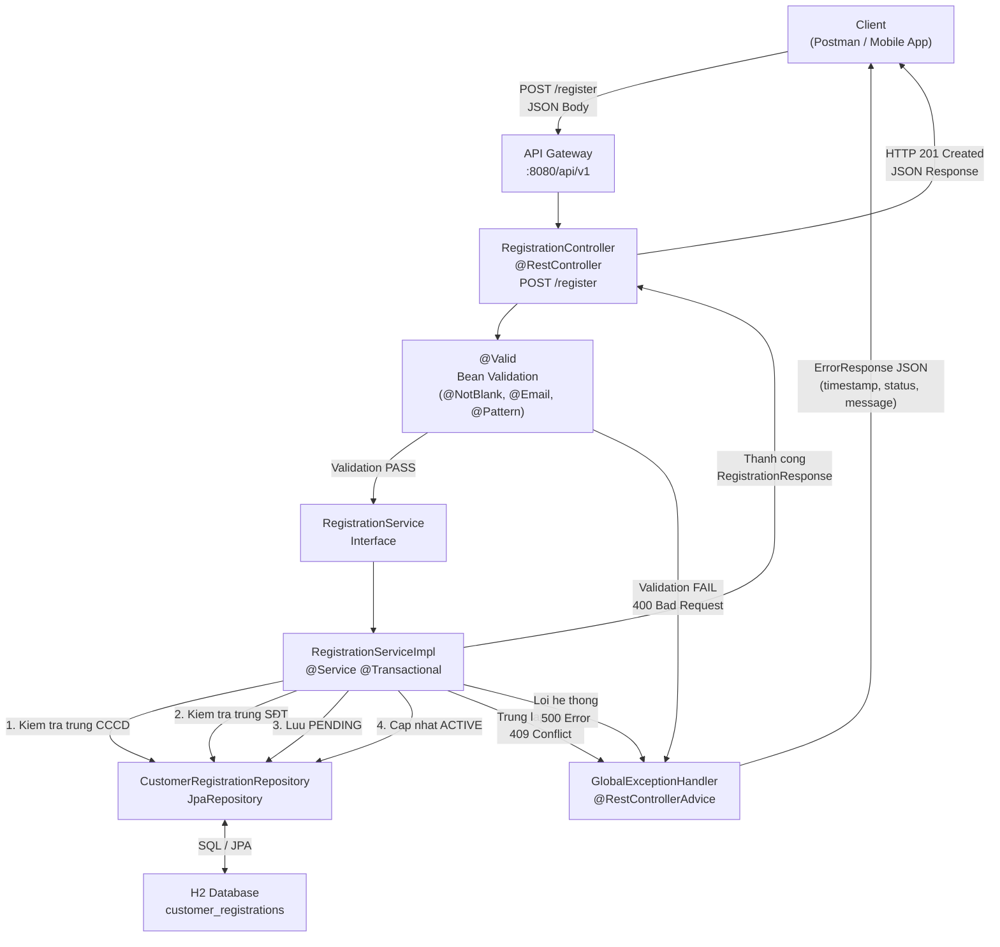

# MÃ NGUỒN SPRING BOOT - API ĐĂNG KÝ TÀI KHOẢN eKYC
## ABC Bank - Bài tập 03

---

## CẤU TRÚC DỰ ÁN

```
ekyc-registration/
├── src/main/java/com/abcbank/ekyc/
│   ├── EkycApplication.java
│   ├── controller/
│   │   └── RegistrationController.java
│   ├── dto/
│   │   ├── RegistrationRequest.java
│   │   └── RegistrationResponse.java
│   ├── entity/
│   │   ├── CustomerRegistration.java
│   │   └── RegistrationStatus.java
│   ├── exception/
│   │   ├── BusinessException.java
│   │   └── ErrorResponse.java
│   ├── repository/
│   │   └── CustomerRegistrationRepository.java
│   └── service/
│       ├── RegistrationService.java
│       └── impl/
│           └── RegistrationServiceImpl.java
├── src/main/resources/
│   └── application.properties
└── pom.xml
```

---

## 1. pom.xml

```xml
<?xml version="1.0" encoding="UTF-8"?>
<project xmlns="http://maven.apache.org/POM/4.0.0"
         xmlns:xsi="http://www.w3.org/2001/XMLSchema-instance"
         xsi:schemaLocation="http://maven.apache.org/POM/4.0.0
         https://maven.apache.org/xsd/maven-4.0.0.xsd">
    <modelVersion>4.0.0</modelVersion>

    <parent>
        <groupId>org.springframework.boot</groupId>
        <artifactId>spring-boot-starter-parent</artifactId>
        <version>3.2.0</version>
        <relativePath/>
    </parent>

    <groupId>com.abcbank</groupId>
    <artifactId>ekyc-registration</artifactId>
    <version>1.0.0</version>
    <name>eKYC Registration API - ABC Bank</name>
    <description>API dang ky mo tai khoan truc tuyen cho he thong eKYC ABC Bank</description>

    <properties>
        <java.version>17</java.version>
    </properties>

    <dependencies>
        <!-- Spring Boot Web - REST API -->
        <dependency>
            <groupId>org.springframework.boot</groupId>
            <artifactId>spring-boot-starter-web</artifactId>
        </dependency>

        <!-- Spring Data JPA - Truy cap CSDL -->
        <dependency>
            <groupId>org.springframework.boot</groupId>
            <artifactId>spring-boot-starter-data-jpa</artifactId>
        </dependency>

        <!-- Validation - Kiem tra du lieu dau vao -->
        <dependency>
            <groupId>org.springframework.boot</groupId>
            <artifactId>spring-boot-starter-validation</artifactId>
        </dependency>

        <!-- H2 Database - CSDL in-memory cho moi truong dev/test -->
        <dependency>
            <groupId>com.h2database</groupId>
            <artifactId>h2</artifactId>
            <scope>runtime</scope>
        </dependency>

        <!-- Lombok - Giam boilerplate code -->
        <dependency>
            <groupId>org.projectlombok</groupId>
            <artifactId>lombok</artifactId>
            <optional>true</optional>
        </dependency>

        <!-- Spring Boot Test -->
        <dependency>
            <groupId>org.springframework.boot</groupId>
            <artifactId>spring-boot-starter-test</artifactId>
            <scope>test</scope>
        </dependency>

        <!-- Mockito - Mock trong unit test -->
        <dependency>
            <groupId>org.mockito</groupId>
            <artifactId>mockito-core</artifactId>
            <scope>test</scope>
        </dependency>
    </dependencies>

    <build>
        <plugins>
            <plugin>
                <groupId>org.springframework.boot</groupId>
                <artifactId>spring-boot-maven-plugin</artifactId>
                <configuration>
                    <excludes>
                        <exclude>
                            <groupId>org.projectlombok</groupId>
                            <artifactId>lombok</artifactId>
                        </exclude>
                    </excludes>
                </configuration>
            </plugin>
        </plugins>
    </build>
</project>
```

---

## 2. src/main/resources/application.properties

```properties
# =============================================================
# Cau hinh ung dung ABC Bank eKYC
# =============================================================

# Thong tin ung dung
spring.application.name=ekyc-registration
server.port=8080

# =============================================================
# Cau hinh CSDL H2 (in-memory - danh cho moi truong dev/test)
# =============================================================
spring.datasource.url=jdbc:h2:mem:ekycdb;DB_CLOSE_DELAY=-1;DB_CLOSE_ON_EXIT=FALSE
spring.datasource.driver-class-name=org.h2.Driver
spring.datasource.username=sa
spring.datasource.password=

# Hien thi H2 Console tai: http://localhost:8080/h2-console
spring.h2.console.enabled=true
spring.h2.console.path=/h2-console

# =============================================================
# Cau hinh JPA / Hibernate
# =============================================================
# create-drop: Tao bang khi khoi dong, xoa khi tat (phu hop test)
spring.jpa.hibernate.ddl-auto=create-drop
spring.jpa.show-sql=true
spring.jpa.properties.hibernate.format_sql=true
spring.jpa.database-platform=org.hibernate.dialect.H2Dialect

# =============================================================
# Cau hinh Logging
# =============================================================
logging.level.com.abcbank.ekyc=DEBUG
logging.level.org.springframework.web=INFO
logging.pattern.console=%d{yyyy-MM-dd HH:mm:ss} [%thread] %-5level %logger{36} - %msg%n
```

---

## 3. Entity: RegistrationStatus.java

```java
package com.abcbank.ekyc.entity;

/**
 * Enum trang thai dang ky tai khoan eKYC
 *
 * <p>Vong doi trang thai:
 * PENDING -> ACTIVE (neu xac thuc thanh cong)
 * PENDING -> REJECTED (neu bi tu choi)
 * </p>
 */
public enum RegistrationStatus {

    /**
     * Dang cho xu ly / chua hoan tat xac thuc
     */
    PENDING,

    /**
     * Da xac thuc thanh cong, tai khoan duoc kich hoat
     */
    ACTIVE,

    /**
     * Bi tu choi (thong tin khong hop le hoac trung lap)
     */
    REJECTED
}
```

---

## 4. Entity: CustomerRegistration.java

```java
package com.abcbank.ekyc.entity;

import jakarta.persistence.*;
import lombok.AllArgsConstructor;
import lombok.Builder;
import lombok.Data;
import lombok.NoArgsConstructor;
import org.hibernate.annotations.CreationTimestamp;
import org.hibernate.annotations.UpdateTimestamp;

import java.time.LocalDateTime;
import java.util.UUID;

/**
 * Entity dai dien cho ho so dang ky mo tai khoan eKYC
 *
 * <p>Anh xa bang {@code customer_registrations} trong CSDL.
 * Luu tru thong tin khach hang va trang thai qua trinh dang ky.</p>
 *
 * @author ABC Bank Dev Team
 * @version 1.0
 */
@Entity
@Table(
    name = "customer_registrations",
    // Rang buoc unique: moi CCCD va SĐT chi dang ky 1 lan (BR-01, BR-02)
    uniqueConstraints = {
        @UniqueConstraint(name = "uk_citizen_id", columnNames = "citizen_id"),
        @UniqueConstraint(name = "uk_phone", columnNames = "phone")
    }
)
@Data
@Builder
@NoArgsConstructor
@AllArgsConstructor
public class CustomerRegistration {

    /**
     * Khoa chinh: UUID tu sinh, dam bao tinh duy nhat toan cau
     */
    @Id
    @GeneratedValue(strategy = GenerationType.UUID)
    @Column(name = "id", updatable = false, nullable = false)
    private UUID id;

    /**
     * Ho va ten day du cua khach hang
     */
    @Column(name = "full_name", nullable = false, length = 100)
    private String fullName;

    /**
     * So dien thoai Viet Nam (10 chu so, dau so hop le)
     */
    @Column(name = "phone", nullable = false, length = 10, unique = true)
    private String phone;

    /**
     * Dia chi email cua khach hang
     */
    @Column(name = "email", nullable = false, length = 255)
    private String email;

    /**
     * So Can cuoc cong dan (CCCD) - 12 chu so (BR-03)
     */
    @Column(name = "citizen_id", nullable = false, length = 12, unique = true)
    private String citizenId;

    /**
     * So tai khoan ngan hang (14 chu so, duoc cap khi ACTIVE)
     * Null neu trang thai con la PENDING
     */
    @Column(name = "account_number", length = 14)
    private String accountNumber;

    /**
     * Trang thai hien tai cua ho so dang ky
     */
    @Enumerated(EnumType.STRING)
    @Column(name = "status", nullable = false, length = 20)
    @Builder.Default
    private RegistrationStatus status = RegistrationStatus.PENDING;

    /**
     * Thoi diem tao ban ghi - tu dong gan boi Hibernate
     */
    @CreationTimestamp
    @Column(name = "created_at", updatable = false)
    private LocalDateTime createdAt;

    /**
     * Thoi diem cap nhat ban ghi lan cuoi - tu dong cap nhat boi Hibernate
     */
    @UpdateTimestamp
    @Column(name = "updated_at")
    private LocalDateTime updatedAt;
}
```

---

## 5. DTO: RegistrationRequest.java

```java
package com.abcbank.ekyc.dto;

import jakarta.validation.constraints.*;
import lombok.AllArgsConstructor;
import lombok.Builder;
import lombok.Data;
import lombok.NoArgsConstructor;

/**
 * DTO chua du lieu dau vao cho API dang ky tai khoan eKYC
 *
 * <p>Tat ca truong deu bat buoc va duoc kiem tra dinh dang
 * truoc khi xu ly nghiep vu.</p>
 */
@Data
@Builder
@NoArgsConstructor
@AllArgsConstructor
public class RegistrationRequest {

    /**
     * Ho va ten day du.
     * Khong duoc trong, toi da 100 ky tu.
     */
    @NotBlank(message = "Ho ten khong duoc de trong")
    @Size(max = 100, message = "Ho ten toi da 100 ky tu")
    private String fullName;

    /**
     * So dien thoai Viet Nam.
     * Bat dau bang 0, 10 chu so, dau so hop le (03x/07x/08x/09x).
     */
    @NotBlank(message = "So dien thoai khong duoc de trong")
    @Pattern(
        regexp = "^(0[3789]\\d{8})$",
        message = "So dien thoai khong hop le (phai la so Viet Nam 10 chu so)"
    )
    private String phone;

    /**
     * Dia chi email.
     * Phai dung dinh dang email chuan theo RFC 5322.
     */
    @NotBlank(message = "Email khong duoc de trong")
    @Email(message = "Dinh dang email khong hop le")
    private String email;

    /**
     * So Can cuoc cong dan (CCCD).
     * Phai la chuoi chinh xac 12 chu so (BR-03).
     */
    @NotBlank(message = "So CCCD khong duoc de trong")
    @Pattern(
        regexp = "^\\d{12}$",
        message = "So CCCD phai la 12 chu so"
    )
    private String citizenId;
}
```

---

## 6. DTO: RegistrationResponse.java

```java
package com.abcbank.ekyc.dto;

import com.abcbank.ekyc.entity.RegistrationStatus;
import lombok.AllArgsConstructor;
import lombok.Builder;
import lombok.Data;
import lombok.NoArgsConstructor;

import java.util.UUID;

/**
 * DTO chua du lieu dau ra cua API dang ky tai khoan eKYC
 */
@Data
@Builder
@NoArgsConstructor
@AllArgsConstructor
public class RegistrationResponse {

    /**
     * UUID dinh danh ho so dang ky (accountId)
     */
    private UUID accountId;

    /**
     * So tai khoan ngan hang (14 chu so).
     * Null neu trang thai la PENDING.
     */
    private String accountNumber;

    /**
     * Trang thai hien tai cua ho so: PENDING, ACTIVE, REJECTED
     */
    private RegistrationStatus status;

    /**
     * Thong bao ket qua gui den khach hang
     */
    private String message;
}
```

---

## 7. Exception: BusinessException.java

```java
package com.abcbank.ekyc.exception;

/**
 * Exception danh cho loi nghiep vu trong qua trinh xu ly eKYC.
 *
 * <p>Vi du: trung so dien thoai, trung CCCD, tai khoan khong ton tai...</p>
 */
public class BusinessException extends RuntimeException {

    private final int statusCode;

    /**
     * Tao BusinessException voi thong bao va HTTP status code
     *
     * @param message   Thong bao loi (co the hien thi cho nguoi dung)
     * @param statusCode HTTP status code tuong ung (vi du: 400, 409, 422)
     */
    public BusinessException(String message, int statusCode) {
        super(message);
        this.statusCode = statusCode;
    }

    public int getStatusCode() {
        return statusCode;
    }
}
```

---

## 8. Exception: ErrorResponse.java

```java
package com.abcbank.ekyc.exception;

import lombok.AllArgsConstructor;
import lombok.Builder;
import lombok.Data;
import lombok.NoArgsConstructor;

import java.time.LocalDateTime;

/**
 * DTO chua thong tin loi tra ve cho client theo dinh dang chuan
 */
@Data
@Builder
@NoArgsConstructor
@AllArgsConstructor
public class ErrorResponse {

    /** Thoi diem xay ra loi */
    private LocalDateTime timestamp;

    /** HTTP status code (vi du: 400, 409, 500) */
    private int status;

    /** Ten loi ngan gon (vi du: "DUPLICATE_CITIZEN_ID") */
    private String error;

    /** Thong bao loi chi tiet */
    private String message;

    /** Duong dan API noi xay ra loi */
    private String path;
}
```

---

## 9. Repository: CustomerRegistrationRepository.java

```java
package com.abcbank.ekyc.repository;

import com.abcbank.ekyc.entity.CustomerRegistration;
import org.springframework.data.jpa.repository.JpaRepository;
import org.springframework.stereotype.Repository;

import java.util.Optional;
import java.util.UUID;

/**
 * Repository truy cap du lieu bang customer_registrations.
 *
 * <p>Spring Data JPA tu dong sinh implementation,
 * khong can viet code SQL thu cong.</p>
 */
@Repository
public interface CustomerRegistrationRepository
        extends JpaRepository<CustomerRegistration, UUID> {

    /**
     * Kiem tra so dien thoai da ton tai chua (BR-02)
     *
     * @param phone So dien thoai can kiem tra
     * @return true neu da ton tai
     */
    boolean existsByPhone(String phone);

    /**
     * Kiem tra so CCCD da ton tai chua (BR-01)
     *
     * @param citizenId So CCCD can kiem tra
     * @return true neu da ton tai
     */
    boolean existsByCitizenId(String citizenId);

    /**
     * Tim kiem ho so theo so CCCD
     *
     * @param citizenId So CCCD
     * @return Optional chua CustomerRegistration neu tim thay
     */
    Optional<CustomerRegistration> findByCitizenId(String citizenId);
}
```

---

## 10. Service Interface: RegistrationService.java

```java
package com.abcbank.ekyc.service;

import com.abcbank.ekyc.dto.RegistrationRequest;
import com.abcbank.ekyc.dto.RegistrationResponse;

/**
 * Interface dinh nghia cac nghiep vu dang ky tai khoan eKYC.
 *
 * <p>Tuan thu nguyen tac Dependency Inversion (SOLID):
 * Controller phu thuoc vao interface nay, khong phu thuoc
 * truc tiep vao implementation.</p>
 */
public interface RegistrationService {

    /**
     * Xu ly dang ky mo tai khoan eKYC moi
     *
     * @param request DTO chua thong tin dang ky cua khach hang
     * @return DTO chua ket qua: accountId, accountNumber, status
     * @throws com.abcbank.ekyc.exception.BusinessException
     *         neu so dien thoai hoac CCCD da ton tai
     */
    RegistrationResponse register(RegistrationRequest request);
}
```

---

## 11. Service Impl: RegistrationServiceImpl.java

```java
package com.abcbank.ekyc.service.impl;

import com.abcbank.ekyc.dto.RegistrationRequest;
import com.abcbank.ekyc.dto.RegistrationResponse;
import com.abcbank.ekyc.entity.CustomerRegistration;
import com.abcbank.ekyc.entity.RegistrationStatus;
import com.abcbank.ekyc.exception.BusinessException;
import com.abcbank.ekyc.repository.CustomerRegistrationRepository;
import com.abcbank.ekyc.service.RegistrationService;
import lombok.RequiredArgsConstructor;
import lombok.extern.slf4j.Slf4j;
import org.springframework.stereotype.Service;
import org.springframework.transaction.annotation.Transactional;

import java.util.Random;

/**
 * Implementation xu ly nghiep vu dang ky tai khoan eKYC
 *
 * <p>Lop nay thuc hien cac buoc:
 * 1. Kiem tra trung lap so dien thoai va CCCD
 * 2. Luu ho so vao CSDL voi trang thai PENDING
 * 3. Mo phong tao so tai khoan
 * 4. Cap nhat trang thai ACTIVE va tra ve ket qua
 * </p>
 */
@Slf4j                    // Tich hop SLF4J logging: su dung bien log.xxx()
@Service
@RequiredArgsConstructor  // Sinh constructor cho cac truong final (Dependency Injection)
@Transactional            // Dam bao toan ven du lieu: rollback neu co loi
public class RegistrationServiceImpl implements RegistrationService {

    /** Repository truy cap CSDL bang customer_registrations */
    private final CustomerRegistrationRepository registrationRepository;

    /** Doi tuong Random de sinh so tai khoan gia lap */
    private final Random random = new Random();

    /**
     * Xu ly dang ky mo tai khoan eKYC moi
     *
     * <p>Luong xu ly:
     * 1. Log bat dau request
     * 2. Kiem tra trung CCCD (BR-01)
     * 3. Kiem tra trung SĐT (BR-02)
     * 4. Tao entity va luu CSDL
     * 5. Sinh so tai khoan gia lap
     * 6. Cap nhat trang thai ACTIVE
     * 7. Log thanh cong va tra ve ket qua
     * </p>
     */
    @Override
    public RegistrationResponse register(RegistrationRequest request) {

        // --- BUOC 1: Log thong tin bat dau xu ly request ---
        log.info("[eKYC-Register] Bat dau xu ly dang ky cho CCCD: {}",
                 maskCitizenId(request.getCitizenId()));

        // --- BUOC 2: Kiem tra CCCD da ton tai chua (BR-01) ---
        if (registrationRepository.existsByCitizenId(request.getCitizenId())) {
            log.warn("[eKYC-Register] CCCD {} da duoc su dung",
                     maskCitizenId(request.getCitizenId()));
            // Nem BusinessException - GlobalExceptionHandler se bat va tra ve loi 409
            throw new BusinessException(
                "So CCCD nay da duoc su dung de dang ky tai khoan. "
                + "Vui long lien he CSKH neu co sai sot.",
                409
            );
        }

        // --- BUOC 3: Kiem tra So dien thoai da ton tai chua (BR-02) ---
        if (registrationRepository.existsByPhone(request.getPhone())) {
            log.warn("[eKYC-Register] So dien thoai {} da duoc dang ky",
                     maskPhone(request.getPhone()));
            throw new BusinessException(
                "So dien thoai nay da lien ket voi mot tai khoan khac. "
                + "Vui long su dung so dien thoai khac.",
                409
            );
        }

        // --- BUOC 4: Tao entity va luu vao CSDL voi trang thai PENDING ---
        CustomerRegistration registration = CustomerRegistration.builder()
                .fullName(request.getFullName())
                .phone(request.getPhone())
                .email(request.getEmail())
                .citizenId(request.getCitizenId())
                .status(RegistrationStatus.PENDING)
                .build();

        // Luu entity - Hibernate tu dong gan id (UUID) va thoi gian tao
        registration = registrationRepository.save(registration);
        log.info("[eKYC-Register] Da luu ho so PENDING, registrationId: {}",
                 registration.getId());

        // --- BUOC 5: Mo phong tao so tai khoan 14 chu so ---
        // (Trong thuc te, buoc nay goi API Core Banking de sinh so tai khoan)
        String accountNumber = generateAccountNumber();
        log.info("[eKYC-Register] Da tao so tai khoan: {}",
                 maskAccountNumber(accountNumber));

        // --- BUOC 6: Cap nhat trang thai ACTIVE va luu so tai khoan ---
        registration.setAccountNumber(accountNumber);
        registration.setStatus(RegistrationStatus.ACTIVE);
        registration = registrationRepository.save(registration);

        // --- BUOC 7: Log thanh cong va tra ve ket qua ---
        log.info("[eKYC-Register] Dang ky thanh cong! AccountId: {}, Status: {}",
                 registration.getId(), registration.getStatus());

        // Xay dung va tra ve DTO phan hoi
        return RegistrationResponse.builder()
                .accountId(registration.getId())
                .accountNumber(registration.getAccountNumber())
                .status(registration.getStatus())
                .message("Dang ky tai khoan thanh cong! "
                       + "So tai khoan cua ban: " + accountNumber
                       + ". Thong tin se duoc gui qua SMS/Email.")
                .build();
    }

    // =========================================================================
    // PRIVATE HELPER METHODS
    // =========================================================================

    /**
     * Sinh so tai khoan ngan hang 14 chu so ngau nhien
     * (Gia lap - thay the bang goi API Core Banking trong production)
     *
     * @return Chuoi 14 chu so dai dien so tai khoan
     */
    private String generateAccountNumber() {
        // Prefix cua ABC Bank: 1901 (4 chu so)
        // Phan con lai: 10 chu so ngau nhien
        StringBuilder sb = new StringBuilder("1901");
        for (int i = 0; i < 10; i++) {
            sb.append(random.nextInt(10)); // Them tung chu so ngau nhien tu 0-9
        }
        return sb.toString();
    }

    /**
     * An mot phan so CCCD de bao mat trong log
     * Vi du: "001234567890" -> "001234***890"
     */
    private String maskCitizenId(String citizenId) {
        if (citizenId == null || citizenId.length() < 6) return "***";
        return citizenId.substring(0, 6) + "***" + citizenId.substring(9);
    }

    /**
     * An mot phan so dien thoai de bao mat trong log
     * Vi du: "0912345678" -> "091****678"
     */
    private String maskPhone(String phone) {
        if (phone == null || phone.length() < 7) return "***";
        return phone.substring(0, 3) + "****" + phone.substring(7);
    }

    /**
     * An mot phan so tai khoan de bao mat trong log
     * Vi du: "19011234567890" -> "1901****7890"
     */
    private String maskAccountNumber(String accountNumber) {
        if (accountNumber == null || accountNumber.length() < 8) return "***";
        return accountNumber.substring(0, 4) + "****"
             + accountNumber.substring(accountNumber.length() - 4);
    }
}
```

---

## 12. Controller: RegistrationController.java

```java
package com.abcbank.ekyc.controller;

import com.abcbank.ekyc.dto.RegistrationRequest;
import com.abcbank.ekyc.dto.RegistrationResponse;
import com.abcbank.ekyc.service.RegistrationService;
import jakarta.validation.Valid;
import lombok.RequiredArgsConstructor;
import lombok.extern.slf4j.Slf4j;
import org.springframework.http.HttpStatus;
import org.springframework.http.ResponseEntity;
import org.springframework.web.bind.annotation.*;

/**
 * REST Controller xu ly cac yeu cau dang ky tai khoan eKYC
 *
 * <p>Base URL: {@code /api/v1/registrations}</p>
 */
@Slf4j
@RestController
@RequestMapping("/api/v1/registrations")
@RequiredArgsConstructor
public class RegistrationController {

    /** Service xu ly nghiep vu dang ky */
    private final RegistrationService registrationService;

    /**
     * API dang ky mo tai khoan eKYC moi
     *
     * <p>
     * <b>POST</b> /api/v1/registrations/register
     * </p>
     *
     * @param request DTO chua thong tin dang ky (fullName, phone, email, citizenId)
     * @return HTTP 201 Created voi thong tin tai khoan neu thanh cong
     */
    @PostMapping("/register")
    public ResponseEntity<RegistrationResponse> register(
            @Valid @RequestBody RegistrationRequest request) {

        log.info("[Controller] Nhan yeu cau dang ky tai khoan moi tu endpoint /register");

        // Goi Service xu ly nghiep vu chinh
        RegistrationResponse response = registrationService.register(request);

        // Tra ve HTTP 201 Created cung ket qua
        log.info("[Controller] Xu ly thanh cong, tra ve HTTP 201");
        return ResponseEntity.status(HttpStatus.CREATED).body(response);
    }

    /**
     * Health check endpoint don gian de kiem tra API con song khong
     *
     * @return HTTP 200 voi thong bao "eKYC API is running"
     */
    @GetMapping("/health")
    public ResponseEntity<String> health() {
        return ResponseEntity.ok("eKYC Registration API - ABC Bank - OK");
    }
}
```

---

## 13. Global Exception Handler: GlobalExceptionHandler.java

```java
package com.abcbank.ekyc.exception;

import lombok.extern.slf4j.Slf4j;
import org.springframework.http.HttpStatus;
import org.springframework.http.ResponseEntity;
import org.springframework.validation.FieldError;
import org.springframework.web.bind.MethodArgumentNotValidException;
import org.springframework.web.bind.annotation.ExceptionHandler;
import org.springframework.web.bind.annotation.RestControllerAdvice;
import org.springframework.web.context.request.WebRequest;

import java.time.LocalDateTime;
import java.util.stream.Collectors;

/**
 * Global Exception Handler - Xu ly tap trung moi loi trong ung dung
 *
 * <p>Annotation @RestControllerAdvice cho phep class nay bat va xu ly
 * tat ca exception tu moi @Controller trong ung dung.
 * Dam bao moi loi deu tra ve dinh dang JSON nhat quan (ErrorResponse DTO).</p>
 */
@Slf4j
@RestControllerAdvice
public class GlobalExceptionHandler {

    /**
     * Xu ly loi nghiep vu (trung lap du lieu, quy tac nghiep vu vi pham)
     *
     * @param ex      BusinessException duoc nem tu Service
     * @param request Thong tin HTTP request
     * @return ResponseEntity voi ErrorResponse va HTTP status tuong ung
     */
    @ExceptionHandler(BusinessException.class)
    public ResponseEntity<ErrorResponse> handleBusinessException(
            BusinessException ex, WebRequest request) {

        log.error("[ExceptionHandler] Loi nghiep vu: {}", ex.getMessage());

        ErrorResponse error = ErrorResponse.builder()
                .timestamp(LocalDateTime.now())
                .status(ex.getStatusCode())
                .error("BUSINESS_RULE_VIOLATION")
                .message(ex.getMessage())
                .path(extractPath(request))
                .build();

        return ResponseEntity.status(ex.getStatusCode()).body(error);
    }

    /**
     * Xu ly loi validation dau vao (@Valid that bai)
     *
     * <p>Khi request body khong thoa man rang buoc @NotBlank, @Email...
     * Spring tu dong nem MethodArgumentNotValidException.</p>
     *
     * @return HTTP 400 Bad Request voi danh sach loi validation
     */
    @ExceptionHandler(MethodArgumentNotValidException.class)
    public ResponseEntity<ErrorResponse> handleValidationException(
            MethodArgumentNotValidException ex, WebRequest request) {

        // Gom tat ca thong bao loi tung truong thanh 1 chuoi
        String errorMessages = ex.getBindingResult()
                .getFieldErrors()
                .stream()
                .map(FieldError::getDefaultMessage)
                .collect(Collectors.joining("; "));

        log.warn("[ExceptionHandler] Loi validation: {}", errorMessages);

        ErrorResponse error = ErrorResponse.builder()
                .timestamp(LocalDateTime.now())
                .status(HttpStatus.BAD_REQUEST.value())
                .error("VALIDATION_FAILED")
                .message(errorMessages)
                .path(extractPath(request))
                .build();

        return ResponseEntity.badRequest().body(error);
    }

    /**
     * Xu ly moi loi khong luong truoc (loi he thong)
     *
     * @return HTTP 500 Internal Server Error
     */
    @ExceptionHandler(Exception.class)
    public ResponseEntity<ErrorResponse> handleGenericException(
            Exception ex, WebRequest request) {

        log.error("[ExceptionHandler] Loi he thong khong mong doi: {}", ex.getMessage(), ex);

        ErrorResponse error = ErrorResponse.builder()
                .timestamp(LocalDateTime.now())
                .status(HttpStatus.INTERNAL_SERVER_ERROR.value())
                .error("INTERNAL_SERVER_ERROR")
                .message("He thong dang gap su co. Vui long thu lai sau hoac lien he ho tro.")
                .path(extractPath(request))
                .build();

        return ResponseEntity.internalServerError().body(error);
    }

    /** Trich xuat duong dan API tu WebRequest */
    private String extractPath(WebRequest request) {
        return request.getDescription(false).replace("uri=", "");
    }
}
```

---

## 14. Main Application: EkycApplication.java

```java
package com.abcbank.ekyc;

import org.springframework.boot.SpringApplication;
import org.springframework.boot.autoconfigure.SpringBootApplication;

/**
 * Diem khoi dau ung dung eKYC Registration API - ABC Bank
 */
@SpringBootApplication
public class EkycApplication {

    public static void main(String[] args) {
        SpringApplication.run(EkycApplication.class, args);
    }
}
```

---

## 15. ARCHITECTURE DIAGRAM (Mermaid)



---

## 16. HUONG DAN CHAY DU AN

### Yeu cau
- Java 17+
- Maven 3.8+

### Buoc 1: Build du an
```bash
mvn clean install
```

### Buoc 2: Chay ung dung
```bash
mvn spring-boot:run
```

### Buoc 3: Test API voi cURL
```bash
# Dang ky thanh cong
curl -X POST http://localhost:8080/api/v1/registrations/register \
  -H "Content-Type: application/json" \
  -d '{
    "fullName": "Nguyen Van An",
    "phone": "0912345678",
    "email": "nguyenvanan@gmail.com",
    "citizenId": "012345678901"
  }'

# Ket qua mong doi (HTTP 201):
# {
#   "accountId": "uuid-xxx",
#   "accountNumber": "19011234567890",
#   "status": "ACTIVE",
#   "message": "Dang ky tai khoan thanh cong! ..."
# }
```

### Buoc 4: Truy cap H2 Console
- URL: http://localhost:8080/h2-console
- JDBC URL: `jdbc:h2:mem:ekycdb`
- Username: `sa`
- Password: (de trong)
